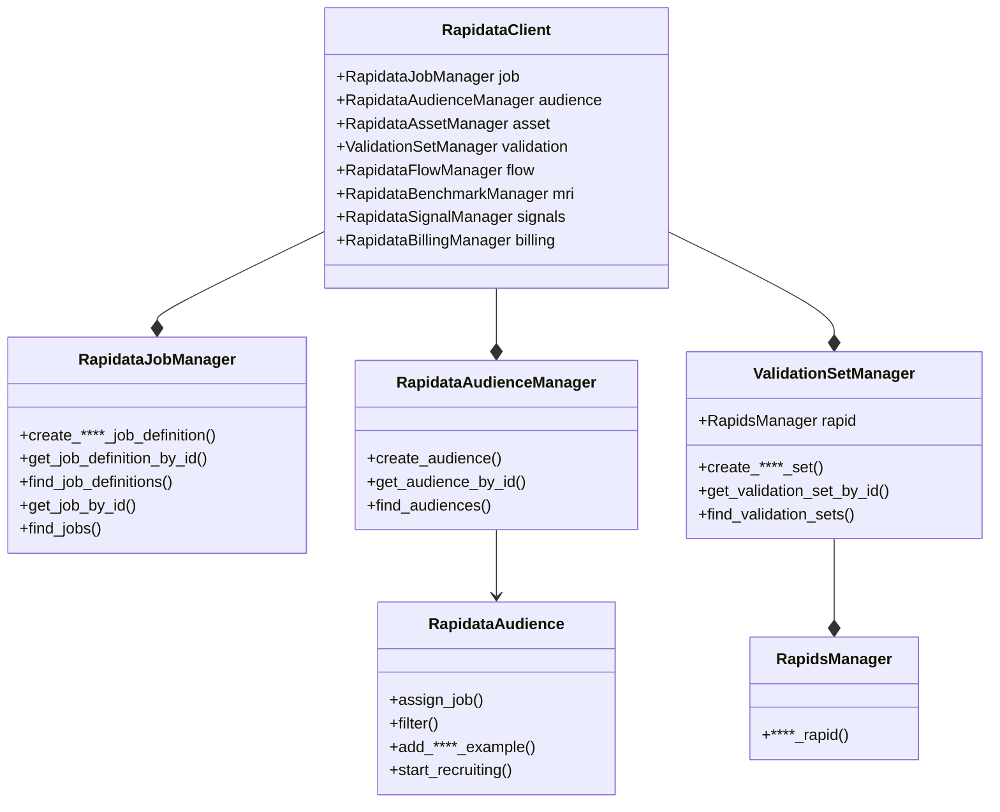

# Rapidata API

The Rapidata API builds on the [RapidataClient](reference/rapidata/rapidata_client/rapidata_client.md) class. This class is the entry point for all operations. You collect labels by creating a **job definition** with `job`, then assigning it to an **audience** — the job runs against that audience's annotators and produces results.

### Job related classes

[RapidataJobManager](reference/rapidata/rapidata_client/job/rapidata_job_manager.md) - accessible through the RapidataClient(rapi) under rapi.job. Creates job definitions and looks up jobs.

[RapidataAudienceManager](reference/rapidata/rapidata_client/audience/rapidata_audience_manager.md) - accessible through the RapidataClient(rapi) under rapi.audience. Creates and looks up audiences.

[RapidataAssetManager](reference/rapidata/rapidata_client/asset/rapidata_asset_manager.md) - accessible through the RapidataClient(rapi) under rapi.asset. Uploads media once and returns an `UploadedAsset` to reuse in job definitions.

[RapidataAudience](reference/rapidata/rapidata_client/audience/rapidata_audience.md) - returned by rapi.audience. Runs a job definition with `assign_job()` and narrows the audience with `filter()`.

Filters (`CountryFilter`, `LanguageFilter`, ...), settings (`NoShuffleSetting`, `RapidataSettings`, ...) and selections (`LabelingSelection`, ...) are imported directly from `rapidata`.

### Validation related classes

[ValidationSetManager](reference/rapidata/rapidata_client/validation/validation_set_manager.md) - accessible through the RapidataClient(rapi) under rapi.validation

[RapidsManager](reference/rapidata/rapidata_client/validation/rapids/rapids_manager.md) - accessible through the RapidataClient(rapi) under rapi.validation.rapid. Used to create specific rapids to be added to a validation set.
